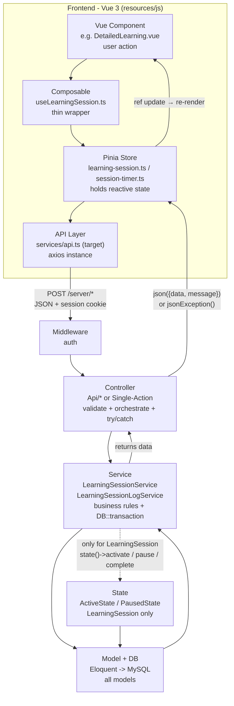

# Request Data Flow — Learning Tracker

End-to-end flow for a usual JSON request: Vue frontend → API Layer → Laravel backend → response.

How to read: top-to-bottom is time. Solid arrows are the main path every request follows. Dashed arrow is an optional branch taken only for `LearningSession`.

## Legend

| Box | Lives in | Role |
|-----|----------|------|
| Vue Component | `resources/js/components/learnings/DetailedLearning.vue:21,73-84` | Captures user intent, calls composable. Never talks HTTP directly in the target design. |
| Composable | `resources/js/composables/useLearningSession.ts:3-10` | Thin pass-through exposing store actions with a stable name. No business logic. |
| Pinia Store | `resources/js/stores/learning-session.ts:10-32`, `resources/js/stores/session-timer.ts:10-18` | Owns client state (`activeLearningSession`), performs the HTTP call, writes response back to refs. |
| API Layer | `resources/js/services/api.ts:3-8` | Single configured `axios` instance (baseURL, JSON headers). All stores should use this. |
| Middleware | `routes/web.php:19`, `bootstrap/app.php:16-24` | Universal concept: `auth` rejects unauthenticated requests before a Controller runs. |
| Controller | `app/Http/Controllers/Api/LearningSessionController.php:33-50`, `app/Http/Controllers/StartLearningSessionController.php:11-20`, base `app/Http/Controllers/Controller.php:11-35` | HTTP translation only: `validate()`, call one Service method, return `json()` / `jsonException()`. |
| Service | `app/Services/LearningSessionService.php:33-58,73-98` | Business rules + transactions. Example: `createLearningSessionAndRunSessionLog()` wraps create + start-log in `DB::transaction`. |
| Model + DB | `app/Models/LearningSession.php`, `app/Models/LearningSessionLog.php`, MySQL tables | Persistence via Eloquent. `LearningSession hasMany LearningSessionLog`. |
| State (optional) | `app/Models/LearningSession.php:31-37`, `app/Contracts/LearningSessionStateContract.php:7-13`, `app/States/LearningSession/ActiveState.php`, `app/States/LearningSession/PausedState.php`, used in `app/Services/LearningSessionService.php:77,88,131` | Legal status transitions for `LearningSession` only (`activate / pause / complete`). |

## Worked example (Save & Run)

`POST /server/learning-sessions/activate-session-and-log { learning_id, name }` → `auth` middleware → `ActivateLearningSessionAndLogController@store` → `validate()` → `LearningSessionService::createLearningSessionAndRunSessionLog()` → `checkIfActiveSessionExists()` throws `ActiveSessionAlreadyExistsException` on conflict, else `LearningSession::create(status=ACTIVE)` in transaction → `state(...)->activate()` where applicable + `LearningSessionLogService` writes start log → Service returns `[$session, $log]` → Controller `json()` → store sets `activeLearningSession` → component re-renders.

## Notes

1. **API Layer is the target, not the present:** `services/api.ts` defines the shared instance, but today `stores/learning-session.ts:1`, `stores/session-timer.ts:1`, and `DetailedLearning.vue:2` import `axios` directly. Planned refactor: route all calls through `services/api.ts` so baseURL/headers/auth handling live in one place.
2. **State is `LearningSession`-only:** `LearningSessionLog`, `Learning`, `Mastery`, `Tag`, `Group` go Service → Model directly and bypass State. If another model gains a lifecycle later, promote State from a dotted branch to a full layer.
